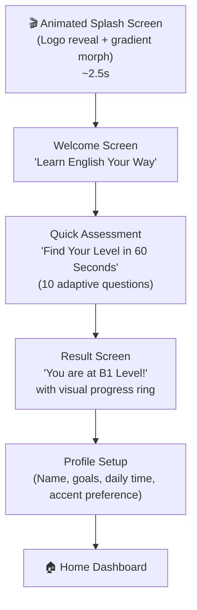
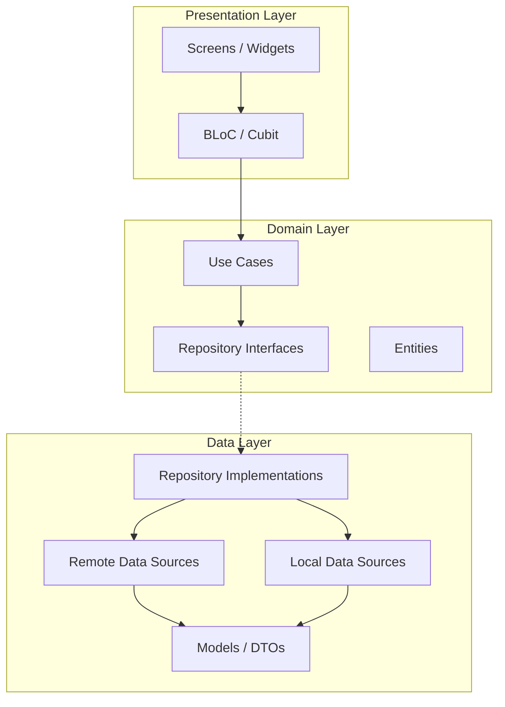
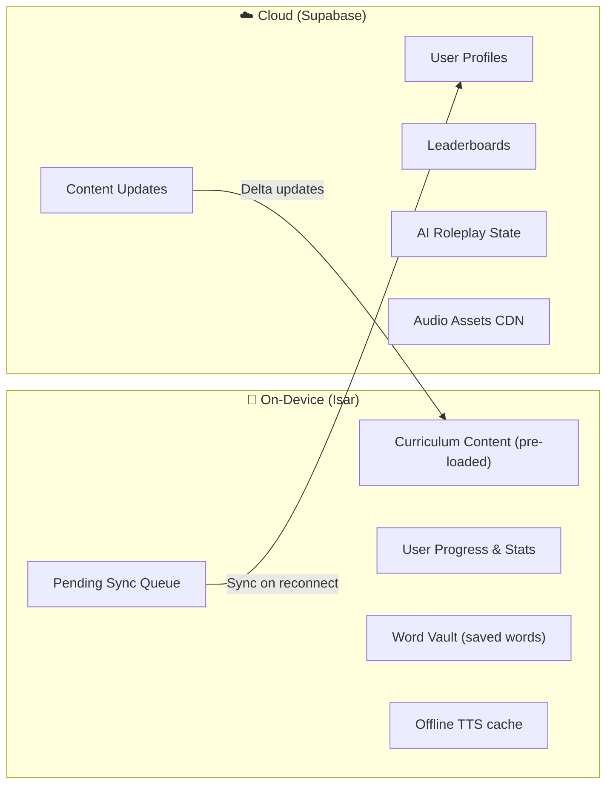
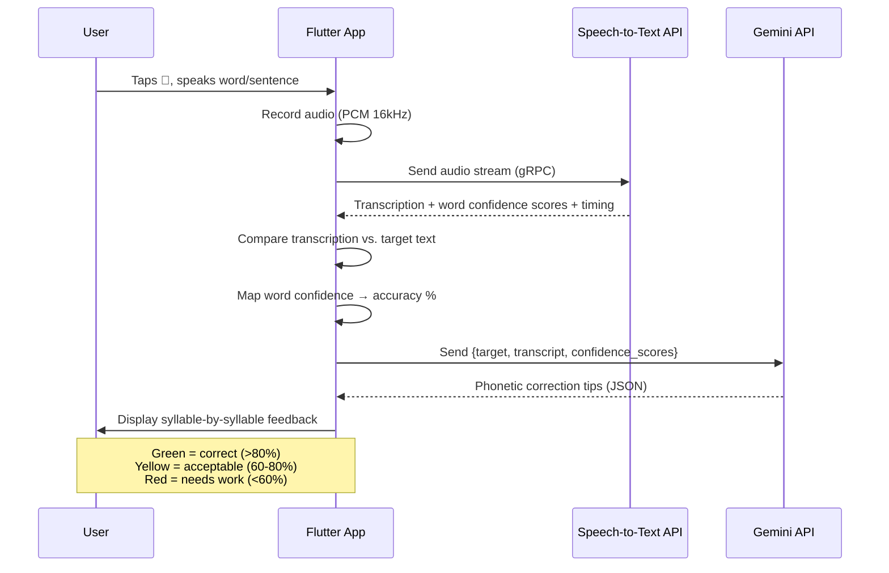
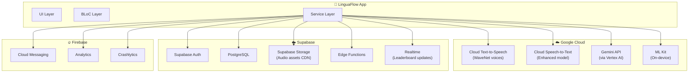
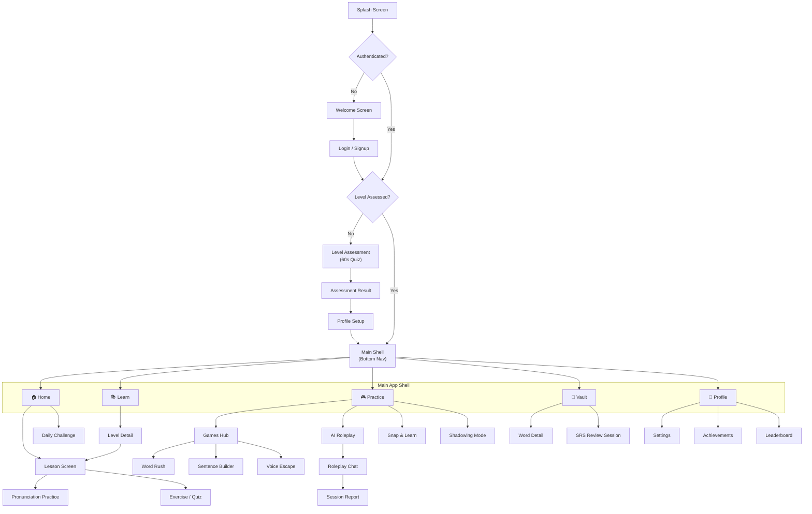
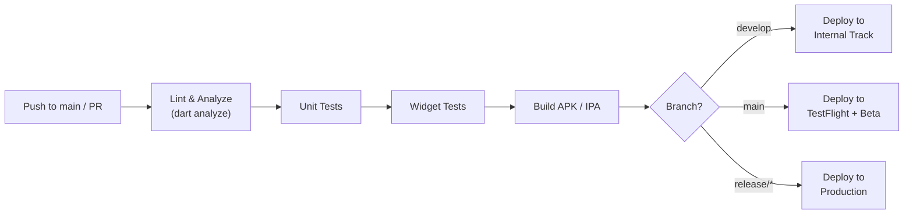

# 🎓 LinguaFlow — English Learning App: Architectural Blueprint

> **Version:** 1.0 · **Date:** November 18, 2026 · **Platform:** Android & iOS (Flutter)

---

## Table of Contents

1. [Product Vision & Identity](#1-product-vision--identity)
2. [UI/UX Design System](#2-uiux-design-system)
3. [Tech Stack & Architecture](#3-tech-stack--architecture)
4. [Folder Structure](#4-folder-structure)
5. [Database Schema](#5-database-schema)
6. [Feature Modules Deep Dive](#6-feature-modules-deep-dive)
7. [API & Service Integration Map](#7-api--service-integration-map)
8. [Screen Flow & Navigation Architecture](#8-screen-flow--navigation-architecture)
9. [Phased Development Roadmap](#9-phased-development-roadmap)
10. [Testing & Quality Strategy](#10-testing--quality-strategy)
11. [Deployment & CI/CD](#11-deployment--cicd)

---

## 1. Product Vision & Identity

### 1.1 App Name: **LinguaFlow**

**Tagline:** *"Speak the World. One Word at a Time."*

### 1.2 Core Value Proposition

| Differentiator | Description |
|---|---|
| **AI-Powered Personalization** | Adaptive difficulty, AI roleplay personas, real-time pronunciation correction |
| **Multi-Sensory Learning** | Voice, camera (AR Snap & Learn), audio shadowing, gamified touch interactions |
| **Structured Progression** | CEFR-aligned curriculum from Absolute Beginner → C2 Mastery |
| **Engagement Loop** | Streaks, XP, leaderboards, voice escape games, daily challenges |

### 1.3 Target Users

- **Primary:** Non-native English speakers (ages 16–45) wanting structured, app-based learning
- **Secondary:** Professionals preparing for IELTS/TOEFL, business English, or workplace communication
- **Tertiary:** Immigrants, travelers, and students in ESL programs

### 1.4 Multi-Level Curriculum Architecture

```mermaid
flowchart LR
    subgraph Level_1["🟢 Absolute Beginner"]
        A1["Alphabet & Phonics"]
        A2["Basic Greetings"]
        A3["Numbers & Colors"]
        A4["Simple Nouns & Verbs"]
    end
    subgraph Level_2["🔵 Elementary (A1-A2)"]
        B1["Daily Conversations"]
        B2["Essential Grammar"]
        B3["Present/Past Tenses"]
        B4["Common Phrases"]
    end
    subgraph Level_3["🟡 Intermediate (B1-B2)"]
        C1["Workplace English"]
        C2["Idioms & Phrasal Verbs"]
        C3["Listening Comprehension"]
        C4["Reading & Writing"]
    end
    subgraph Level_4["🔴 Advanced (C1-C2)"]
        D1["Business Negotiations"]
        D2["Academic Writing"]
        D3["Native Nuances"]
        D4["Debate & Rhetoric"]
    end

    Level_1 --> Level_2 --> Level_3 --> Level_4
```



### 1.5 Categorized Learning Sections

Each level contains these **six core skill pillars**:

| Pillar | Icon | Focus |
|---|---|---|
| **Vocabulary** | 📖 | Words, phrases, IPA transcription, SRS flashcards |
| **Grammar** | 📐 | Rules, exercises, fill-in-the-blank, error correction |
| **Listening** | 🎧 | Audio clips, dictation, comprehension quizzes |
| **Speaking** | 🎤 | Record & compare, pronunciation scoring, shadowing |
| **Reading** | 📰 | Passages, articles, comprehension questions |
| **Real-Life Scenarios** | 🌍 | Airport, Restaurant, Job Interview, Business Meeting, Doctor Visit |

---

## 2. UI/UX Design System

### 2.1 Design Principles

1. **Dark-First:** Default dark theme; light mode as a toggle
2. **Gamified but Professional:** Sleek, modern aesthetic — not cartoonish
3. **Micro-Animation Rich:** Smooth transitions, haptic feedback, progress celebrations
4. **Thumb-Zone Optimized:** Critical actions reachable with one hand
5. **Accessibility:** WCAG 2.1 AA compliant, scalable text, screen reader support

### 2.2 Color Palette

| Role | Dark Mode | Light Mode | Usage |
|---|---|---|---|
| **Background** | `#0D0D1A` | `#F5F5FA` | Main canvas |
| **Surface** | `#1A1A2E` | `#FFFFFF` | Cards, sheets |
| **Primary** | `#6C63FF` | `#5A52D5` | Buttons, active states |
| **Secondary** | `#00D9A6` | `#00B88C` | Success, correct answers |
| **Accent** | `#FF6B6B` | `#E05555` | Errors, streaks, gamification |
| **Text Primary** | `#EAEAEF` | `#1A1A2E` | Headings, body |
| **Text Secondary** | `#8888A0` | `#6B6B80` | Hints, captions |
| **XP Gold** | `#FFD700` | `#E6C200` | XP badges, rewards |

### 2.3 Typography

| Style | Font | Size | Weight |
|---|---|---|---|
| **Display** | Poppins | 32sp | Bold (700) |
| **Headline** | Poppins | 24sp | SemiBold (600) |
| **Title** | Inter | 20sp | Medium (500) |
| **Body** | Inter | 16sp | Regular (400) |
| **Caption** | Inter | 12sp | Regular (400) |
| **Phonetic (IPA)** | Noto Sans | 14sp | Regular (400) |

### 2.4 Splash Screen & Onboarding Flow



**Splash Screen Details:**
- **Phase 1 (0–1s):** Dark background, logo icon scales from 0 → 1 with spring physics
- **Phase 2 (1–1.8s):** Gradient sweep (deep purple → teal) radiates outward from logo
- **Phase 3 (1.8–2.5s):** App name "LinguaFlow" types in letter by letter, tagline fades up
- **Tech:** `flutter_animate` + custom `AnimationController` with `CurvedAnimation`

### 2.5 Navigation Architecture

**Primary:** Bottom Navigation Bar (5 tabs)

| Tab | Icon | Screen |
|---|---|---|
| 🏠 Home | `home_filled` | Dashboard, daily challenge, continue learning |
| 📚 Learn | `book_open` | Curriculum browser, levels, lessons |
| 🎮 Practice | `gamepad` | Mini-games, voice practice, quizzes |
| 💾 Vault | `bookmark` | Word Vault (saved words), SRS review queue |
| 👤 Profile | `person` | Stats, settings, achievements, leaderboard |

**Secondary:** Top contextual app bar with back navigation, search, and notifications

### 2.6 Key Screen Wireframes (Descriptions)

#### Home Dashboard
```
┌──────────────────────────────────┐
│  🔥 Day 14 Streak    ⚡ 2,450 XP │
├──────────────────────────────────┤
│  ┌────────────────────────────┐  │
│  │ 📊 Daily Progress Ring     │  │
│  │    72% Complete Today      │  │
│  │    [Continue Lesson →]     │  │
│  └────────────────────────────┘  │
│                                  │
│  🎯 Daily Challenge             │
│  ┌────────────────────────────┐  │
│  │ "Pronounce 5 B1 phrases"  │  │
│  │  ████████░░ 3/5 done      │  │
│  └────────────────────────────┘  │
│                                  │
│  📈 Skill Radar                 │
│  ┌────────────────────────────┐  │
│  │   Vocab ●━━━━━━━● 78%     │  │
│  │   Grammar ●━━━━━● 65%     │  │
│  │   Listening ●━━━● 52%     │  │
│  │   Speaking ●━━● 40%       │  │
│  └────────────────────────────┘  │
│                                  │
│  🌍 Quick Scenario              │
│  [Airport] [Restaurant] [Job]   │
├──────────────────────────────────┤
│  🏠    📚    🎮    💾    👤     │
└──────────────────────────────────┘
```

#### Lesson Screen (Vocabulary)
```
┌──────────────────────────────────┐
│  ← B1 Vocabulary: Workplace     │
├──────────────────────────────────┤
│  ████████████░░░░ Lesson 3/8    │
│                                  │
│  ┌────────────────────────────┐  │
│  │          📸                │  │
│  │    [Image of "deadline"]   │  │
│  │                            │  │
│  │   deadline                 │  │
│  │   /ˈdɛd.laɪn/             │  │
│  │   🔊 US  🔊 UK  🐢 Slow   │  │
│  │                            │  │
│  │   "The deadline for the    │  │
│  │    report is Friday."      │  │
│  │                            │  │
│  │   📌 Translation: الموعد   │  │
│  │       النهائي              │  │
│  └────────────────────────────┘  │
│                                  │
│  [💾 Save to Vault]             │
│                                  │
│  🎤 [Tap to Pronounce]          │
│  ┌────────────────────────────┐  │
│  │ Accuracy: 87% ✅           │  │
│  │ "dead" ✅  "line" ⚠️       │  │
│  │ Tip: Round your lips more  │  │
│  │ on the /aɪ/ sound          │  │
│  └────────────────────────────┘  │
│                                  │
│       [← Prev]  [Next →]        │
└──────────────────────────────────┘
```

#### AI Roleplay Screen
```
┌──────────────────────────────────┐
│  ← AI Roleplay: Job Interview   │
├──────────────────────────────────┤
│  ┌────────────────────────────┐  │
│  │  🤖 Sarah Chen             │  │
│  │  "Tech CEO at StartupX"    │  │
│  │  Difficulty: B2             │  │
│  └────────────────────────────┘  │
│                                  │
│  💬 Chat Transcript:            │
│  ┌────────────────────────────┐  │
│  │ 🤖: Tell me about your     │  │
│  │     experience with...      │  │
│  │                             │  │
│  │ 👤: I have worked in...     │  │
│  │     [Accuracy: 91%]         │  │
│  │                             │  │
│  │ 🤖: That's interesting.     │  │
│  │     Can you elaborate on... │  │
│  └────────────────────────────┘  │
│                                  │
│  ┌────────────────────────────┐  │
│  │ 🎙️ [Hold to Speak]         │  │
│  │                             │  │
│  │ 💡 Suggested response:      │  │
│  │ "In my previous role..."    │  │
│  └────────────────────────────┘  │
│                                  │
│  [End Session → Get Report]      │
└──────────────────────────────────┘
```

---

## 3. Tech Stack & Architecture

### 3.1 Architecture Pattern: **Clean Architecture + BLoC**



### 3.2 Full Tech Stack

| Layer | Technology | Purpose |
|---|---|---|
| **Framework** | Flutter 3.x (Dart) | Cross-platform UI |
| **State Management** | flutter_bloc 8.x | BLoC + Cubit pattern |
| **Dependency Injection** | get_it + injectable | Service locator + code gen |
| **Navigation** | go_router | Declarative routing, deep links |
| **Local Database** | Isar 4.x | High-performance NoSQL, offline-first |
| **Remote Database** | Supabase (PostgreSQL) | Auth, real-time sync, storage, edge functions |
| **Authentication** | Supabase Auth + Google/Apple Sign-In | OAuth2, magic links, social login |
| **Text-to-Speech** | flutter_tts + Google Cloud TTS API | Dual-engine: offline basic + cloud high-quality |
| **Speech-to-Text** | google_speech (gRPC) + speech_to_text | On-device fallback + cloud accuracy |
| **AI / LLM** | Google Gemini API (via Vertex AI) | Roleplay personas, grammar correction, adaptive content |
| **AR / Camera** | google_mlkit_object_detection + camera | Real-world object scanning ("Snap & Learn") |
| **Audio Processing** | just_audio + audio_waveforms | Playback, recording, waveform visualization |
| **Animations** | flutter_animate + rive | Micro-interactions, gamification celebrations |
| **Push Notifications** | Firebase Cloud Messaging (FCM) | SRS reminders, streak nudges, daily challenges |
| **Analytics** | Firebase Analytics + Crashlytics | Usage tracking, crash reporting |
| **Payments (Future)** | RevenueCat | Subscriptions, IAP (freemium model) |
| **CI/CD** | Codemagic / GitHub Actions | Automated build, test, deploy |
| **Internationalization** | flutter_localizations + intl | Multi-language UI support |

### 3.3 Offline-First Strategy



> [!IMPORTANT]
> Core learning (lessons, vocabulary, grammar exercises, TTS, basic quizzes) must work fully offline. Cloud features (AI roleplay, Snap & Learn, leaderboards, speech scoring) require connectivity but degrade gracefully with cached results and queued uploads.

---

## 4. Folder Structure

```
lingua_flow/
├── android/                          # Android native config
├── ios/                              # iOS native config
├── assets/
│   ├── animations/                   # Rive/Lottie animation files
│   │   ├── splash_logo.riv
│   │   ├── streak_fire.riv
│   │   ├── level_up.riv
│   │   └── confetti.json
│   ├── audio/
│   │   ├── us/                       # American English pronunciations
│   │   │   ├── alphabet/
│   │   │   ├── words/
│   │   │   └── sentences/
│   │   ├── uk/                       # British English pronunciations
│   │   │   ├── alphabet/
│   │   │   ├── words/
│   │   │   └── sentences/
│   │   └── sfx/                      # Sound effects (correct, wrong, level-up)
│   ├── fonts/
│   │   ├── Poppins/
│   │   ├── Inter/
│   │   └── NotoSans/
│   ├── images/
│   │   ├── onboarding/
│   │   ├── avatars/                  # AI persona avatars
│   │   ├── scenarios/                # Real-life scenario illustrations
│   │   └── badges/                   # Achievement badges
│   ├── content/                      # Pre-loaded curriculum data (JSON)
│   │   ├── levels/
│   │   │   ├── beginner.json
│   │   │   ├── elementary.json
│   │   │   ├── intermediate.json
│   │   │   └── advanced.json
│   │   ├── vocabulary/
│   │   ├── grammar/
│   │   ├── scenarios/
│   │   └── quizzes/
│   └── i18n/                         # Localization files
│       ├── app_en.arb
│       └── app_ar.arb
│
├── lib/
│   ├── main.dart                     # App entry point
│   ├── app.dart                      # MaterialApp / Theme config
│   ├── injection.dart                # Dependency injection setup
│   │
│   ├── core/                         # Shared core utilities
│   │   ├── constants/
│   │   │   ├── app_colors.dart
│   │   │   ├── app_text_styles.dart
│   │   │   ├── app_dimensions.dart
│   │   │   ├── api_endpoints.dart
│   │   │   └── asset_paths.dart
│   │   ├── errors/
│   │   │   ├── failures.dart
│   │   │   └── exceptions.dart
│   │   ├── network/
│   │   │   ├── network_info.dart
│   │   │   └── api_client.dart
│   │   ├── theme/
│   │   │   ├── app_theme.dart
│   │   │   ├── dark_theme.dart
│   │   │   └── light_theme.dart
│   │   ├── router/
│   │   │   ├── app_router.dart
│   │   │   └── route_names.dart
│   │   ├── utils/
│   │   │   ├── date_utils.dart
│   │   │   ├── audio_utils.dart
│   │   │   ├── srs_algorithm.dart    # SM-2 spaced repetition algorithm
│   │   │   └── xp_calculator.dart
│   │   └── widgets/                  # Reusable UI components
│   │       ├── animated_progress_ring.dart
│   │       ├── audio_player_widget.dart
│   │       ├── pronunciation_badge.dart
│   │       ├── xp_counter.dart
│   │       ├── streak_flame.dart
│   │       ├── word_card.dart
│   │       ├── accuracy_meter.dart
│   │       ├── waveform_visualizer.dart
│   │       └── loading_shimmer.dart
│   │
│   ├── features/                     # Feature-first modular structure
│   │   │
│   │   ├── splash/
│   │   │   ├── presentation/
│   │   │   │   ├── screens/
│   │   │   │   │   └── splash_screen.dart
│   │   │   │   └── widgets/
│   │   │   │       └── animated_logo.dart
│   │   │   └── bloc/
│   │   │       └── splash_cubit.dart
│   │   │
│   │   ├── onboarding/
│   │   │   ├── presentation/
│   │   │   │   ├── screens/
│   │   │   │   │   ├── welcome_screen.dart
│   │   │   │   │   ├── level_assessment_screen.dart
│   │   │   │   │   ├── assessment_result_screen.dart
│   │   │   │   │   └── profile_setup_screen.dart
│   │   │   │   └── widgets/
│   │   │   │       ├── assessment_question_card.dart
│   │   │   │       └── level_badge.dart
│   │   │   ├── bloc/
│   │   │   │   ├── onboarding_bloc.dart
│   │   │   │   └── onboarding_state.dart
│   │   │   ├── domain/
│   │   │   │   ├── entities/
│   │   │   │   │   └── assessment_result.dart
│   │   │   │   ├── usecases/
│   │   │   │   │   └── evaluate_level.dart
│   │   │   │   └── repositories/
│   │   │   │       └── onboarding_repository.dart
│   │   │   └── data/
│   │   │       ├── models/
│   │   │       │   └── assessment_question_model.dart
│   │   │       ├── datasources/
│   │   │       │   └── assessment_local_datasource.dart
│   │   │       └── repositories/
│   │   │           └── onboarding_repository_impl.dart
│   │   │
│   │   ├── auth/
│   │   │   ├── presentation/
│   │   │   │   ├── screens/
│   │   │   │   │   ├── login_screen.dart
│   │   │   │   │   └── signup_screen.dart
│   │   │   │   └── widgets/
│   │   │   │       └── social_login_buttons.dart
│   │   │   ├── bloc/
│   │   │   │   ├── auth_bloc.dart
│   │   │   │   ├── auth_event.dart
│   │   │   │   └── auth_state.dart
│   │   │   ├── domain/
│   │   │   │   ├── entities/
│   │   │   │   │   └── user.dart
│   │   │   │   ├── usecases/
│   │   │   │   │   ├── sign_in.dart
│   │   │   │   │   ├── sign_up.dart
│   │   │   │   │   └── sign_out.dart
│   │   │   │   └── repositories/
│   │   │   │       └── auth_repository.dart
│   │   │   └── data/
│   │   │       ├── models/
│   │   │       │   └── user_model.dart
│   │   │       ├── datasources/
│   │   │       │   ├── auth_remote_datasource.dart
│   │   │       │   └── auth_local_datasource.dart
│   │   │       └── repositories/
│   │   │           └── auth_repository_impl.dart
│   │   │
│   │   ├── home/
│   │   │   ├── presentation/
│   │   │   │   ├── screens/
│   │   │   │   │   └── home_screen.dart
│   │   │   │   └── widgets/
│   │   │   │       ├── daily_progress_card.dart
│   │   │   │       ├── daily_challenge_card.dart
│   │   │   │       ├── skill_radar_chart.dart
│   │   │   │       ├── streak_header.dart
│   │   │   │       └── quick_scenario_chips.dart
│   │   │   └── bloc/
│   │   │       ├── home_bloc.dart
│   │   │       └── home_state.dart
│   │   │
│   │   ├── curriculum/               # Learn tab — curriculum browser
│   │   │   ├── presentation/
│   │   │   │   ├── screens/
│   │   │   │   │   ├── curriculum_screen.dart
│   │   │   │   │   ├── level_detail_screen.dart
│   │   │   │   │   └── lesson_screen.dart
│   │   │   │   └── widgets/
│   │   │   │       ├── level_card.dart
│   │   │   │       ├── skill_tab_bar.dart
│   │   │   │       ├── lesson_list_tile.dart
│   │   │   │       └── lesson_progress_indicator.dart
│   │   │   ├── bloc/
│   │   │   │   ├── curriculum_bloc.dart
│   │   │   │   └── lesson_bloc.dart
│   │   │   ├── domain/
│   │   │   │   ├── entities/
│   │   │   │   │   ├── level.dart
│   │   │   │   │   ├── lesson.dart
│   │   │   │   │   ├── vocabulary_item.dart
│   │   │   │   │   └── grammar_rule.dart
│   │   │   │   ├── usecases/
│   │   │   │   │   ├── get_levels.dart
│   │   │   │   │   ├── get_lessons.dart
│   │   │   │   │   └── complete_lesson.dart
│   │   │   │   └── repositories/
│   │   │   │       └── curriculum_repository.dart
│   │   │   └── data/
│   │   │       ├── models/
│   │   │       │   ├── level_model.dart
│   │   │       │   ├── lesson_model.dart
│   │   │       │   └── vocabulary_model.dart
│   │   │       ├── datasources/
│   │   │       │   ├── curriculum_local_datasource.dart
│   │   │       │   └── curriculum_remote_datasource.dart
│   │   │       └── repositories/
│   │   │           └── curriculum_repository_impl.dart
│   │   │
│   │   ├── pronunciation/           # TTS + STT engine
│   │   │   ├── presentation/
│   │   │   │   ├── screens/
│   │   │   │   │   └── pronunciation_practice_screen.dart
│   │   │   │   └── widgets/
│   │   │   │       ├── accent_toggle.dart
│   │   │   │       ├── speed_control.dart
│   │   │   │       ├── record_button.dart
│   │   │   │       ├── syllable_feedback.dart
│   │   │   │       └── accuracy_score_ring.dart
│   │   │   ├── bloc/
│   │   │   │   ├── tts_cubit.dart
│   │   │   │   └── stt_bloc.dart
│   │   │   ├── domain/
│   │   │   │   ├── entities/
│   │   │   │   │   ├── pronunciation_result.dart
│   │   │   │   │   └── phoneme_analysis.dart
│   │   │   │   ├── usecases/
│   │   │   │   │   ├── speak_text.dart
│   │   │   │   │   ├── analyze_pronunciation.dart
│   │   │   │   │   └── get_phonetic_tips.dart
│   │   │   │   └── repositories/
│   │   │   │       └── pronunciation_repository.dart
│   │   │   └── data/
│   │   │       ├── datasources/
│   │   │       │   ├── tts_service.dart
│   │   │       │   └── stt_service.dart
│   │   │       └── repositories/
│   │   │           └── pronunciation_repository_impl.dart
│   │   │
│   │   ├── word_vault/               # Smart Vocabulary Bank
│   │   │   ├── presentation/
│   │   │   │   ├── screens/
│   │   │   │   │   ├── word_vault_screen.dart
│   │   │   │   │   ├── word_detail_screen.dart
│   │   │   │   │   └── srs_review_screen.dart
│   │   │   │   └── widgets/
│   │   │   │       ├── word_vault_list_tile.dart
│   │   │   │       ├── srs_flashcard.dart
│   │   │   │       └── review_schedule_badge.dart
│   │   │   ├── bloc/
│   │   │   │   ├── word_vault_bloc.dart
│   │   │   │   └── srs_cubit.dart
│   │   │   ├── domain/
│   │   │   │   ├── entities/
│   │   │   │   │   ├── saved_word.dart
│   │   │   │   │   └── srs_card.dart
│   │   │   │   ├── usecases/
│   │   │   │   │   ├── save_word.dart
│   │   │   │   │   ├── get_review_queue.dart
│   │   │   │   │   └── update_srs_schedule.dart
│   │   │   │   └── repositories/
│   │   │   │       └── word_vault_repository.dart
│   │   │   └── data/
│   │   │       ├── models/
│   │   │       │   └── saved_word_model.dart
│   │   │       ├── datasources/
│   │   │       │   └── word_vault_local_datasource.dart
│   │   │       └── repositories/
│   │   │           └── word_vault_repository_impl.dart
│   │   │
│   │   ├── games/                    # Gamified Practice
│   │   │   ├── presentation/
│   │   │   │   ├── screens/
│   │   │   │   │   ├── games_hub_screen.dart
│   │   │   │   │   ├── word_rush_screen.dart
│   │   │   │   │   ├── sentence_builder_screen.dart
│   │   │   │   │   └── voice_escape_screen.dart
│   │   │   │   └── widgets/
│   │   │   │       ├── game_card.dart
│   │   │   │       ├── drag_drop_tile.dart
│   │   │   │       ├── countdown_timer.dart
│   │   │   │       └── xp_earned_popup.dart
│   │   │   ├── bloc/
│   │   │   │   ├── word_rush_bloc.dart
│   │   │   │   ├── sentence_builder_bloc.dart
│   │   │   │   └── voice_escape_bloc.dart
│   │   │   └── domain/
│   │   │       ├── entities/
│   │   │       │   ├── game_session.dart
│   │   │       │   └── game_result.dart
│   │   │       └── usecases/
│   │   │           ├── start_game.dart
│   │   │           └── submit_game_result.dart
│   │   │
│   │   ├── ai_roleplay/             # AI Persona Chat
│   │   │   ├── presentation/
│   │   │   │   ├── screens/
│   │   │   │   │   ├── roleplay_menu_screen.dart
│   │   │   │   │   ├── roleplay_chat_screen.dart
│   │   │   │   │   └── roleplay_report_screen.dart
│   │   │   │   └── widgets/
│   │   │   │       ├── persona_avatar.dart
│   │   │   │       ├── chat_bubble.dart
│   │   │   │       ├── voice_input_bar.dart
│   │   │   │       └── roleplay_feedback_card.dart
│   │   │   ├── bloc/
│   │   │   │   ├── roleplay_bloc.dart
│   │   │   │   └── roleplay_state.dart
│   │   │   ├── domain/
│   │   │   │   ├── entities/
│   │   │   │   │   ├── persona.dart
│   │   │   │   │   ├── roleplay_session.dart
│   │   │   │   │   └── roleplay_feedback.dart
│   │   │   │   ├── usecases/
│   │   │   │   │   ├── start_roleplay.dart
│   │   │   │   │   ├── send_message.dart
│   │   │   │   │   └── end_session.dart
│   │   │   │   └── repositories/
│   │   │   │       └── roleplay_repository.dart
│   │   │   └── data/
│   │   │       ├── datasources/
│   │   │       │   └── gemini_ai_datasource.dart
│   │   │       └── repositories/
│   │   │           └── roleplay_repository_impl.dart
│   │   │
│   │   ├── snap_learn/              # AR Camera Object Scanner
│   │   │   ├── presentation/
│   │   │   │   ├── screens/
│   │   │   │   │   ├── camera_scan_screen.dart
│   │   │   │   │   └── scan_result_screen.dart
│   │   │   │   └── widgets/
│   │   │   │       ├── camera_overlay.dart
│   │   │   │       ├── object_label_tag.dart
│   │   │   │       └── instant_quiz_bottom_sheet.dart
│   │   │   ├── bloc/
│   │   │   │   └── snap_learn_bloc.dart
│   │   │   ├── domain/
│   │   │   │   ├── entities/
│   │   │   │   │   └── scanned_object.dart
│   │   │   │   └── usecases/
│   │   │   │       ├── identify_object.dart
│   │   │   │       └── generate_quiz.dart
│   │   │   └── data/
│   │   │       ├── datasources/
│   │   │       │   └── ml_kit_datasource.dart
│   │   │       └── repositories/
│   │   │           └── snap_learn_repository_impl.dart
│   │   │
│   │   ├── shadowing/               # Context Shadowing Mode
│   │   │   ├── presentation/
│   │   │   │   ├── screens/
│   │   │   │   │   └── shadowing_screen.dart
│   │   │   │   └── widgets/
│   │   │   │       ├── split_screen_player.dart
│   │   │   │       ├── waveform_comparison.dart
│   │   │   │       └── rhythm_score_badge.dart
│   │   │   ├── bloc/
│   │   │   │   └── shadowing_bloc.dart
│   │   │   └── domain/
│   │   │       ├── entities/
│   │   │       │   └── shadowing_result.dart
│   │   │       └── usecases/
│   │   │           └── compare_waveforms.dart
│   │   │
│   │   ├── leaderboard/
│   │   │   ├── presentation/
│   │   │   │   ├── screens/
│   │   │   │   │   └── leaderboard_screen.dart
│   │   │   │   └── widgets/
│   │   │   │       ├── leaderboard_tile.dart
│   │   │   │       └── rank_badge.dart
│   │   │   └── bloc/
│   │   │       └── leaderboard_bloc.dart
│   │   │
│   │   ├── profile/
│   │   │   ├── presentation/
│   │   │   │   ├── screens/
│   │   │   │   │   ├── profile_screen.dart
│   │   │   │   │   ├── settings_screen.dart
│   │   │   │   │   └── achievements_screen.dart
│   │   │   │   └── widgets/
│   │   │   │       ├── stats_grid.dart
│   │   │   │       ├── achievement_badge.dart
│   │   │   │       └── theme_toggle.dart
│   │   │   └── bloc/
│   │   │       ├── profile_bloc.dart
│   │   │       └── settings_cubit.dart
│   │   │
│   │   └── notifications/
│   │       ├── domain/
│   │       │   └── usecases/
│   │       │       ├── schedule_srs_reminder.dart
│   │       │       └── send_streak_nudge.dart
│   │       └── data/
│   │           └── fcm_service.dart
│   │
│   └── l10n/                        # Generated localization
│       ├── app_localizations.dart
│       └── app_localizations_en.dart
│
├── test/
│   ├── unit/
│   │   ├── core/
│   │   │   └── srs_algorithm_test.dart
│   │   ├── features/
│   │   │   ├── curriculum/
│   │   │   ├── pronunciation/
│   │   │   ├── word_vault/
│   │   │   └── games/
│   │   └── ...
│   ├── widget/
│   │   ├── word_card_test.dart
│   │   ├── accuracy_meter_test.dart
│   │   └── ...
│   └── integration/
│       ├── onboarding_flow_test.dart
│       ├── lesson_completion_test.dart
│       └── ...
│
├── pubspec.yaml
├── analysis_options.yaml
├── l10n.yaml
├── build.yaml
└── README.md
```

---

## 5. Database Schema

### 5.1 Local Database (Isar Collections)

```mermaid
erDiagram
    User ||--o{ UserProgress : tracks
    User ||--o{ SavedWord : saves
    User ||--o{ GameResult : plays
    User ||--o{ RoleplaySession : participates
    User {
        string id PK
        string displayName
        string email
        string avatarUrl
        int currentLevelId
        int totalXp
        int currentStreak
        int longestStreak
        datetime lastActiveDate
        string preferredAccent "US | UK"
        bool isDarkMode
        string nativeLanguage
        int dailyGoalMinutes
        datetime createdAt
    }

    Level ||--o{ Lesson : contains
    Level {
        int id PK
        string name "Beginner | Elementary | Intermediate | Advanced"
        string cefrCode "Pre-A1 | A1 | A2 | B1 | B2 | C1 | C2"
        string description
        string iconAsset
        string colorHex
        int sortOrder
        bool isLocked
    }

    Lesson ||--o{ LessonContent : has
    Lesson {
        int id PK
        int levelId FK
        string skillPillar "vocabulary | grammar | listening | speaking | reading | scenario"
        string title
        string description
        int sortOrder
        int estimatedMinutes
        int xpReward
    }

    LessonContent {
        int id PK
        int lessonId FK
        string contentType "word | grammar_rule | exercise | audio_clip | passage | dialogue"
        string jsonData "flexible JSON payload per type"
        int sortOrder
    }

    VocabularyItem {
        int id PK
        string word
        string ipa "phonetic transcription"
        string definition
        string translation
        string partOfSpeech
        list exampleSentences
        string audioPathUS
        string audioPathUK
        string imageUrl
        int levelId FK
        list tags
    }

    GrammarRule {
        int id PK
        string title
        string explanation
        string formula "e.g. Subject + Verb + Object"
        list examples
        list exercises "JSON array of exercise configs"
        int levelId FK
    }

    UserProgress {
        int id PK
        string odUserId FK
        int lessonId FK
        string status "not_started | in_progress | completed"
        int scorePercent
        int xpEarned
        int timeSpentSeconds
        datetime completedAt
        int attempts
    }

    SavedWord {
        int id PK
        string userId FK
        int vocabularyItemId FK
        datetime savedAt
        int srsLevel "0-8 (SM-2 interval)"
        double srsFactor "easiness factor"
        int srsInterval "days until next review"
        datetime nextReviewDate
        int reviewCount
        int correctCount
    }

    GameResult {
        int id PK
        string odUserId FK
        string gameType "word_rush | sentence_builder | voice_escape"
        int score
        int xpEarned
        int durationSeconds
        datetime playedAt
    }

    RoleplaySession {
        int id PK
        string userId FK
        string personaId
        string scenario
        list messages "JSON conversation log"
        int overallScore
        string feedbackSummary
        int durationSeconds
        datetime sessionDate
    }

    ScannedObject {
        int id PK
        string userId FK
        string objectLabel
        string englishWord
        string ipa
        string audioPath
        string imageThumbnailPath
        datetime scannedAt
        bool addedToVault
    }

    Achievement {
        int id PK
        string key "unique identifier"
        string title
        string description
        string iconAsset
        int xpReward
    }

    UserAchievement {
        int id PK
        string userId FK
        int achievementId FK
        datetime unlockedAt
    }

    DailyActivity {
        int id PK
        string userId FK
        datetime date
        int lessonsCompleted
        int wordsLearned
        int minutesSpent
        int xpEarned
        int gamesPlayed
        bool streakMaintained
    }
```



### 5.2 Remote Database (Supabase / PostgreSQL)

The remote database mirrors key tables for sync and adds server-only tables:

| Table | Purpose | Sync Direction |
|---|---|---|
| `profiles` | User profiles, preferences | Bi-directional |
| `user_progress` | Lesson completion, scores | Device → Cloud |
| `leaderboard` | Weekly/monthly rankings | Cloud → Device |
| `saved_words` | Word vault items | Bi-directional |
| `content_versions` | Curriculum update metadata | Cloud → Device |
| `roleplay_logs` | AI conversation history | Device → Cloud |
| `daily_activity` | Streak & activity data | Device → Cloud |
| `achievements` | Master achievement definitions | Cloud → Device |
| `user_achievements` | Unlocked achievements | Bi-directional |

### 5.3 Supabase Edge Functions

| Function | Trigger | Purpose |
|---|---|---|
| `calculate-leaderboard` | Cron (every 6h) | Aggregate XP, rank users, update leaderboard |
| `send-srs-reminder` | Cron (daily 9 AM user timezone) | Push notification for due SRS reviews |
| `send-streak-nudge` | Cron (daily 8 PM user timezone) | Nudge users who haven't practiced today |
| `sync-progress` | On INSERT to `user_progress` | Validate, deduplicate, merge progress |
| `generate-daily-challenge` | Cron (midnight UTC) | Create personalized daily challenges |

---

## 6. Feature Modules Deep Dive

### 6.1 Native Pronunciation Engine (TTS)

**Dual-Engine Strategy:**

| Engine | When Used | Quality | Latency |
|---|---|---|---|
| **flutter_tts (on-device)** | Offline, quick playback | Good | <100ms |
| **Google Cloud TTS (WaveNet)** | Online, lesson context, word details | Excellent (near-native) | 200–500ms |

**Implementation Details:**
- **Speed Control:** `1.0x` (normal) and `0.6x` (slow) via `setSpeechRate()`
- **Accent Toggle:** `en-US` for American, `en-GB` for British; persisted in user preferences
- **Audio Caching:** Cloud TTS responses cached locally (Isar) keyed by `word + accent + speed` hash
- **Pre-loading:** Lesson audio pre-fetched on WiFi in background isolate

### 6.2 AI Speech Recognition & Pronunciation Scoring



**Scoring Algorithm:**
1. **Word-level accuracy** = `correct_words / total_words × 100`
2. **Confidence weighting** = per-word confidence from STT API (0.0–1.0)
3. **Phoneme analysis** = Gemini API parses IPA differences and returns structured correction tips
4. **Final Score** = weighted average of word accuracy (60%) + pronunciation confidence (40%)

### 6.3 Smart Vocabulary Bank — SRS Algorithm (SM-2)

```
┌─────────────────────────────────────────────────────┐
│                 SM-2 Algorithm Flow                  │
│                                                     │
│  On review, user rates quality q (0–5):             │
│                                                     │
│  if q < 3:  // Incorrect                            │
│    interval = 1 day (reset)                         │
│    repetition = 0                                   │
│  else:  // Correct                                  │
│    if repetition == 0: interval = 1                 │
│    elif repetition == 1: interval = 6               │
│    else: interval = interval × easeFactor           │
│                                                     │
│    easeFactor = max(1.3, EF + 0.1 - (5-q)          │
│                × (0.08 + (5-q) × 0.02))            │
│    repetition += 1                                  │
│                                                     │
│  nextReviewDate = today + interval                  │
└─────────────────────────────────────────────────────┘
```

- **Review Queue:** Sorted by `nextReviewDate <= today`, urgent first
- **Notifications:** FCM push at user's preferred time for due reviews
- **Flashcard UI:** Swipe-based (Tinder-style) with flip animation for answer reveal

### 6.4 Interactive Mini-Games

| Game | Mechanic | XP | Skills Practiced |
|---|---|---|---|
| **Word Rush** | Speed-match word to definition/image (60s timer) | 10–50 | Vocabulary recall |
| **Sentence Builder** | Drag-and-drop word tiles into correct sentence order | 15–60 | Grammar, word order |
| **Voice Escape** | Pronounce phrases correctly to "unlock doors" in a visual maze | 20–80 | Speaking, pronunciation |
| **Daily Streak Challenge** | 5 mixed questions per day; maintain streak for bonus XP | 25 + streak bonus | Mixed skills |

### 6.5 AI Roleplay Persona

**Available Personas (Initial Set):**

| Persona | Scenario | CEFR Level | Personality |
|---|---|---|---|
| 👮 Officer Rivera | Airport Customs | A2–B1 | Stern, procedural |
| ☕ Maya | Coffee Shop Order | A1–A2 | Warm, patient |
| 👔 Sarah Chen | Job Interview | B1–B2 | Professional, probing |
| 🏢 James Mitchell | Business Negotiation | B2–C1 | Assertive, strategic |
| 🎓 Dr. Williams | Academic Discussion | C1–C2 | Intellectual, Socratic |
| 🛒 Shopkeeper Ali | Market Haggling | A2–B1 | Cheerful, persuasive |

**AI Pipeline:**
1. System prompt encodes persona personality, scenario rules, user level, and conversation history
2. Gemini API generates context-aware responses with difficulty calibrated to user level
3. User speaks → STT → text inserted into conversation → Gemini continues
4. Post-session: Gemini generates a structured feedback report (grammar errors, vocabulary suggestions, fluency score)

### 6.6 AR Snap & Learn

**Pipeline:**
1. `camera` plugin opens live viewfinder
2. `google_mlkit_object_detection` runs on-device model for real-time bounding boxes
3. Detected label (e.g., "laptop") → lookup in vocabulary database
4. Display: English word + IPA + audio pronunciation button
5. "Quick Quiz" bottom sheet: 3 multiple-choice questions about the scanned object
6. Option to save to Word Vault

### 6.7 Context Shadowing Mode

**Split-Screen Layout:**
```
┌─────────────────────────────────┐
│  🎬 Native Speaker Clip         │
│  [▶ Video/Audio Player]         │
│  ═══════════════════ waveform   │
├─────────────────────────────────┤
│  🎤 Your Recording              │
│  [● Record]                     │
│  ═══════════════════ waveform   │
├─────────────────────────────────┤
│  📊 Comparison                  │
│  Rhythm Match: 76%              │
│  Intonation Match: 68%          │
│  Overall: 72%                   │
└─────────────────────────────────┘
```

**Analysis:**
- Extract pitch contour from both waveforms using FFT
- Compare rhythm patterns (syllable timing) using Dynamic Time Warping (DTW)
- Visual overlay of both waveforms for user self-assessment

---

## 7. API & Service Integration Map



### API Key Management

> [!CAUTION]
> Never hardcode API keys. Use `--dart-define` for build-time injection, `flutter_dotenv` for local development, and Supabase Edge Functions as a secure proxy for sensitive keys (Gemini, Cloud TTS/STT).

| Secret | Storage Method |
|---|---|
| Supabase URL / Anon Key | `--dart-define` (compile-time) |
| Google Cloud API Key | Supabase Edge Function proxy (never on device) |
| Gemini API Key | Supabase Edge Function proxy |
| Firebase Config | `google-services.json` / `GoogleService-Info.plist` |

---

## 8. Screen Flow & Navigation Architecture



### go_router Configuration Summary

| Route | Path | Screen |
|---|---|---|
| Splash | `/` | `SplashScreen` |
| Welcome | `/welcome` | `WelcomeScreen` |
| Login | `/auth/login` | `LoginScreen` |
| Sign Up | `/auth/signup` | `SignupScreen` |
| Assessment | `/onboarding/assessment` | `LevelAssessmentScreen` |
| Assessment Result | `/onboarding/result` | `AssessmentResultScreen` |
| Profile Setup | `/onboarding/profile-setup` | `ProfileSetupScreen` |
| Home | `/home` | `HomeScreen` |
| Learn | `/learn` | `CurriculumScreen` |
| Level Detail | `/learn/level/:levelId` | `LevelDetailScreen` |
| Lesson | `/learn/lesson/:lessonId` | `LessonScreen` |
| Practice | `/practice` | `GamesHubScreen` |
| Word Rush | `/practice/word-rush` | `WordRushScreen` |
| Sentence Builder | `/practice/sentence-builder` | `SentenceBuilderScreen` |
| Voice Escape | `/practice/voice-escape` | `VoiceEscapeScreen` |
| AI Roleplay | `/practice/roleplay` | `RoleplayMenuScreen` |
| Roleplay Chat | `/practice/roleplay/:personaId` | `RoleplayChatScreen` |
| Snap & Learn | `/practice/snap-learn` | `CameraScanScreen` |
| Shadowing | `/practice/shadowing` | `ShadowingScreen` |
| Vault | `/vault` | `WordVaultScreen` |
| Word Detail | `/vault/word/:wordId` | `WordDetailScreen` |
| SRS Review | `/vault/review` | `SrsReviewScreen` |
| Profile | `/profile` | `ProfileScreen` |
| Settings | `/profile/settings` | `SettingsScreen` |
| Achievements | `/profile/achievements` | `AchievementsScreen` |
| Leaderboard | `/profile/leaderboard` | `LeaderboardScreen` |

---

## 9. Phased Development Roadmap

### Phase 0: Foundation (Weeks 1–2)

| Task | Details | Priority |
|---|---|---|
| Project scaffolding | Flutter project, folder structure, `pubspec.yaml` dependencies | 🔴 Critical |
| Theme system | Dark/Light mode, color palette, typography, `ThemeData` | 🔴 Critical |
| DI setup | `get_it` + `injectable` configuration | 🔴 Critical |
| Router setup | `go_router` with all route definitions | 🔴 Critical |
| Isar DB setup | Schema definitions, migrations, initialization | 🔴 Critical |
| Supabase integration | Auth, database client, storage client | 🔴 Critical |
| Core widgets library | Progress ring, word card, loading shimmer, etc. | 🟡 High |
| Asset pipeline | Font loading, image optimization, audio directory | 🟡 High |

### Phase 1: Core Learning Experience (Weeks 3–6)

| Task | Details | Priority |
|---|---|---|
| Splash screen | Animated logo, gradient, typewriter text | 🔴 Critical |
| Onboarding flow | Welcome, assessment quiz, result, profile setup | 🔴 Critical |
| Auth screens | Login, sign up, social sign-in (Google/Apple) | 🔴 Critical |
| Home dashboard | Streak, XP, daily progress, challenge card, skill radar | 🔴 Critical |
| Curriculum browser | Level cards, skill pillars, lesson lists | 🔴 Critical |
| Lesson viewer | Vocabulary cards, grammar explanations, exercises | 🔴 Critical |
| TTS integration | flutter_tts setup, accent toggle, speed control | 🔴 Critical |
| Curriculum content | Author JSON content for Beginner + Elementary levels | 🔴 Critical |
| Progress tracking | Lesson completion, XP accumulation, streak logic | 🟡 High |
| Bottom navigation | 5-tab shell with persistent state | 🔴 Critical |

### Phase 2: Voice & Intelligence (Weeks 7–10)

| Task | Details | Priority |
|---|---|---|
| STT integration | Recording UI, speech-to-text pipeline, accuracy scoring | 🔴 Critical |
| Pronunciation feedback | Syllable-level color coding, accuracy %, phonetic tips | 🔴 Critical |
| Cloud TTS upgrade | Google Cloud WaveNet voices, caching layer | 🟡 High |
| Gemini AI integration | API client, prompt engineering, response parsing | 🔴 Critical |
| AI Roleplay (basic) | 2 personas, text-based chat, voice input | 🔴 Critical |
| Word Vault | Save words, translations, IPA, audio, example sentences | 🔴 Critical |
| SRS engine | SM-2 algorithm, review scheduling, flashcard UI | 🟡 High |
| FCM notifications | SRS reminders, streak nudges | 🟡 High |

### Phase 3: Gamification & Engagement (Weeks 11–14)

| Task | Details | Priority |
|---|---|---|
| Word Rush game | Speed-matching mechanic, timer, scoring | 🟡 High |
| Sentence Builder | Drag-and-drop puzzle, grammar validation | 🟡 High |
| Voice Escape | Visual maze + pronunciation gates | 🟡 High |
| XP & Leaderboard | XP calculation, weekly/monthly boards, Supabase realtime | 🟡 High |
| Achievements system | 20+ achievements, unlock animations, badge gallery | 🟡 High |
| Daily challenges | Auto-generated, personalized, streak bonuses | 🟡 High |
| Remaining AI personas | 4 more personas, advanced scenario logic | 🟡 High |
| Intermediate content | Author B1-B2 curriculum content | 🟡 High |

### Phase 4: Innovative Features (Weeks 15–18)

| Task | Details | Priority |
|---|---|---|
| Snap & Learn | Camera integration, ML Kit, label → vocab lookup, mini-quiz | 🟢 Medium |
| Context Shadowing | Split-screen player, waveform visualizer, DTW comparison | 🟢 Medium |
| Advanced content | Author C1-C2 curriculum content | 🟢 Medium |
| Real-Life Scenarios | Airport, Restaurant, Job Interview, Doctor (interactive dialogues) | 🟡 High |
| Offline robustness | Full offline lesson experience, sync queue hardening | 🟡 High |
| Settings & Profile polish | Theme toggle, accent prefs, daily goals, stats visualizations | 🟢 Medium |

### Phase 5: Polish & Launch (Weeks 19–22)

| Task | Details | Priority |
|---|---|---|
| Performance optimization | Frame rate profiling, image caching, lazy loading | 🔴 Critical |
| Accessibility audit | Screen reader, contrast, touch targets, font scaling | 🔴 Critical |
| Localization | UI strings for 2–3 initial languages | 🟡 High |
| Analytics events | Track key user actions, funnel analysis | 🟡 High |
| Crash reporting | Crashlytics integration, error boundaries | 🔴 Critical |
| App Store assets | Screenshots, descriptions, preview video | 🔴 Critical |
| Beta testing | TestFlight + Google Play Internal Track | 🔴 Critical |
| Bug fixes & polish | UI edge cases, animation smoothness, micro-interactions | 🔴 Critical |
| **v1.0 Launch** 🚀 | App Store + Google Play submission | 🔴 Critical |

### Post-Launch Roadmap

| Milestone | Features |
|---|---|
| **v1.1** (Month 2) | RevenueCat payments, premium tier, additional content packs |
| **v1.2** (Month 3) | Social features (friends, challenges, shared word lists) |
| **v1.3** (Month 4) | IELTS/TOEFL prep modules, mock tests |
| **v2.0** (Month 6) | Multi-language support (Spanish, French, German learning) |

---

## 10. Testing & Quality Strategy

### Test Coverage Targets

| Layer | Coverage | Tool |
|---|---|---|
| **Unit Tests** (domain, utils, algorithms) | ≥90% | `flutter_test`, `mockito`, `bloc_test` |
| **Widget Tests** (components, screens) | ≥75% | `flutter_test`, `golden_toolkit` |
| **Integration Tests** (user flows) | Key flows | `integration_test`, `patrol` |
| **E2E / QA** | Full regression | Manual + Device Farms |

### Key Test Scenarios

1. **SRS Algorithm:** Verify SM-2 interval calculations for all quality ratings (0–5)
2. **Pronunciation Scoring:** Mock STT responses, verify score calculation and feedback generation
3. **Offline Mode:** Complete a lesson with airplane mode, verify local save, verify sync on reconnect
4. **Streak Logic:** Edge cases — midnight boundary, timezone changes, missed day recovery
5. **Game Mechanics:** Timer accuracy, score calculation, XP award correctness
6. **Auth Flow:** Sign up → Assessment → Profile Setup → Home (golden path)
7. **Data Sync:** Conflict resolution when local and cloud data diverge

---

## 11. Deployment & CI/CD

### CI/CD Pipeline (Codemagic / GitHub Actions)



### Environment Configuration

| Environment | Supabase Project | Gemini Endpoint | Analytics |
|---|---|---|---|
| **dev** | `linguaflow-dev` | Staging | Debug mode |
| **staging** | `linguaflow-staging` | Staging | Enabled |
| **production** | `linguaflow-prod` | Production | Enabled |

### Release Checklist

- [ ] All tests passing (unit, widget, integration)
- [ ] No analyzer warnings
- [ ] Performance profiling pass (60fps on mid-range devices)
- [ ] Accessibility audit completed
- [ ] App size < 50MB (initial download)
- [ ] All content reviewed for accuracy
- [ ] Privacy policy & Terms of Service updated
- [ ] App Store / Play Store listing finalized
- [ ] Crash-free rate baseline established

---

## Key Dependencies (`pubspec.yaml`)

```yaml
dependencies:
  flutter:
    sdk: flutter

  # State Management
  flutter_bloc: ^8.1.6
  equatable: ^2.0.7

  # Navigation
  go_router: ^14.6.0

  # Dependency Injection
  get_it: ^8.0.2
  injectable: ^2.5.0

  # Local Database
  isar: ^4.0.0
  isar_flutter_libs: ^4.0.0

  # Remote Backend
  supabase_flutter: ^2.8.0

  # Firebase
  firebase_core: ^3.8.0
  firebase_messaging: ^15.1.5
  firebase_analytics: ^11.3.5
  firebase_crashlytics: ^4.1.5

  # Text-to-Speech
  flutter_tts: ^4.2.0

  # Speech-to-Text
  speech_to_text: ^7.0.0

  # AI
  google_generative_ai: ^0.4.6  # Gemini SDK

  # Camera & ML
  camera: ^0.11.0+2
  google_mlkit_object_detection: ^0.14.0

  # Audio
  just_audio: ^0.9.42
  record: ^5.1.3
  audio_waveforms: ^1.2.0

  # Animations
  flutter_animate: ^4.5.2
  rive: ^0.13.14

  # UI Utilities
  flutter_svg: ^2.0.15
  cached_network_image: ^3.4.1
  shimmer: ^3.0.0
  fl_chart: ^0.69.2  # Radar chart, progress charts

  # Utilities
  dartz: ^0.10.1  # Functional programming (Either)
  freezed_annotation: ^2.4.6
  json_annotation: ^4.9.0
  intl: ^0.19.0
  shared_preferences: ^2.3.4
  connectivity_plus: ^6.1.0
  permission_handler: ^11.3.1
  uuid: ^4.5.1

dev_dependencies:
  flutter_test:
    sdk: flutter
  bloc_test: ^9.1.7
  mockito: ^5.4.4
  build_runner: ^2.4.13
  freezed: ^2.5.7
  json_serializable: ^6.8.0
  injectable_generator: ^2.6.3
  isar_generator: ^4.0.0
  flutter_lints: ^5.0.0
  golden_toolkit: ^0.15.0
  integration_test:
    sdk: flutter
```

---

> [!TIP]
> **Estimated Timeline:** 22 weeks (5.5 months) for a small team (2 Flutter devs + 1 backend dev + 1 designer + 1 content writer). Solo development would take ~9–12 months.

> [!NOTE]
> **Monetization (Future):** Freemium model — Beginner + Elementary levels free; Intermediate, Advanced, AI Roleplay (unlimited), Snap & Learn, and Shadowing behind a subscription (via RevenueCat). Pricing tiers: Monthly (\$9.99), Annual (\$59.99), Lifetime (\$149.99).

---

**🟢 Status: Awaiting approval to proceed with boilerplate code generation.**
